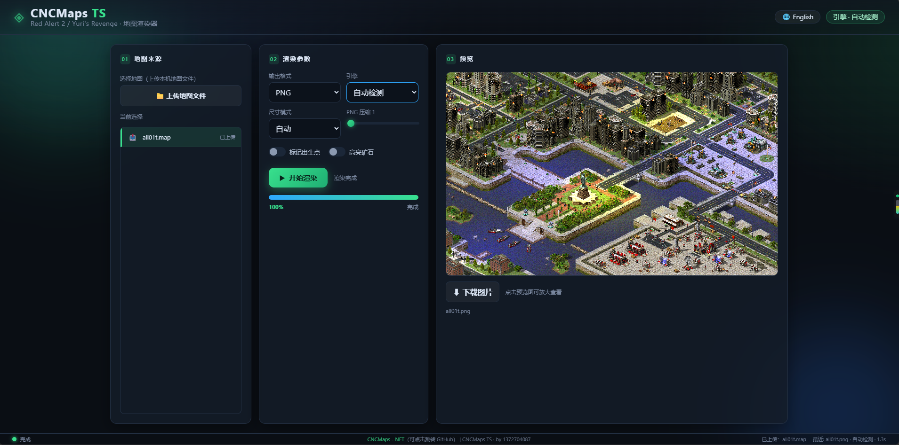

# CNCMaps TS（TypeScript 移植版）

[Red Alert 2 / Yuri's Revenge / Tiberian Sun / Firestorm](http://cncnet.org) 地图渲染器的 TypeScript 移植版。原版为 [ccmaps-net](https://github.com/zzattack/ccmaps-net)（Frank Razenberg / zzattack 使用 C#/.NET 编写），本项目将其移植到 TypeScript / Node.js，并附带一个本地 Web 上传渲染前端。



*完整工作流：上传地图 → 配置渲染参数 → 渲染 → 预览 / 放大查看 / 下载。*

## 功能

- 解析 `.map` / `.yrm` / `.mpr` 地图文件
- 支持引擎：Red Alert 2、Yuri's Revenge、Tiberian Sun、Firestorm（TS/FS 为泰伯利亚之日及其资料片火风暴）
- 从游戏安装目录读取 `.mix`（rules.ini、art.ini、tiles、SHP 动画、VXL 渲染）进行离线渲染
- 渲染选项：
  - 输出格式 PNG / JPG，可自定义缩放尺寸
  - 分层 PSD 导出：地形、建筑、步兵、载具、飞行器、海军、地形对象、覆盖物、污染物各一个图层
  - 出生点标记（红色方块）
  - 矿石 / 宝石高亮
  - 光照
  - 强制指定引擎（RA2 / YR / TS / FS / 自动侦测）
- Web 端「上传地图 → 渲染 → 预览 / 放大查看 / 下载」一站式流程：
  - 服务器内置一份游戏文件，客户端只需上传地图文件，无需本地游戏路径
  - NDJSON 流式渲染进度
  - 结果图内存缓存（30 分钟，最多 16 张）

## 快速开始

### 环境要求

- Node.js 18.17+（Node 22 已实测；`npm run build:all` 需要 esbuild）
- 一份游戏安装目录（含 `*.mix` 文件）：Red Alert 2 / Yuri's Revenge / Tiberian Sun / Firestorm 任一

### 构建

```bash
npm install
npm run build:all
```

`npm run build` 只编译 Node 侧引擎；`build:all` 还会打包浏览器 Worker（`src/web/static/webworker/cncmaps-worker.js`）。运行 `npm test` 会先编译再执行全部单元测试（golden 对比测试在未设置 `CNCMAPS_MIX_DIR` 时自动跳过）。

### 命令行渲染（CLI）

```bash
node dist/cli.js \
  --infile="path\to\map.map" \
  --mixdir="path\to\game\dir" \
  --outdir="path\to\output" \
  --output-png \
  --force-yr
```

不指定 `--output-png` / `--output-jpg` 时默认写 PNG。JPEG 由 `jpeg-js` 编码，质量和 PNG 压缩级别都会被安全夹到合法范围，非法数值不会再让渲染崩溃。

`--output-psd` 写出分层 PSD：地形、建筑、步兵、载具、飞行器、海军、地形对象、覆盖物、污染物各一个图层组。地形组内是整图合并层；其余组内按对象拆成独立图层，图层名优先使用游戏 CSF 字符串表里的本地化名称并带所在格子（中文版客户端即 `发电厂 (22,20)`、`灰熊坦克 (24,21)`、`美国大兵 (21,22)`），CSF 没有条目的对象回退内部 ID（如 `TREE22 (28,29)`）；覆盖物与污染物按类型合并，避免矿石/污渍产生成千上万个单格图层。每层保留该元素绘制时游戏实际画出的像素：被后续对象遮挡的部分仍留在自己的图层里，但被深度测试挡下的像素不会写入，保证图层叠放顺序和游戏画面一致。树、建筑、单位的影子跟随各自的对象图层（半透明黑色，等价于游戏里压暗 50%），在 Photoshop 里拖动对象时影子一起移动；出生点、隧道线等标注仍留在地形层。PSD 需要整图渲染，超大地图会提示改用 PNG/JPEG。追加 `--psd-preview` 会同时写出一张扁平化 PNG（`<名称>.preview.png`），浏览器无法解码 PSD，Web 界面用它来做预览。

常用参数：

| 参数 | 说明 |
| ---- | ---- |
| `-i, --infile` | 输入地图文件（必填） |
| `-m, --mixdir` | 游戏目录，渲染所需 `.mix` 文件来源 |
| `-d, --outdir` | 输出目录 |
| `-p, --output-png` | 输出 PNG（默认） |
| `-j, --output-jpg` | 输出 JPG；同时给出两者时 PNG 优先 |
| `--output-psd` | 输出分层 PSD；须整图渲染，地图上限约 3200 万像素、单边 30000px |
| `--psd-preview` | 配合 `--output-psd` 额外输出扁平化 PNG 预览（`<名称>.preview.png`） |
| `-q, --jpeg-quality` | JPEG 质量 1–100（默认 92） |
| `-c, --png-compression` | PNG zlib 级别 1–9（默认 4） |
| `--preview-width` | 将输出缩放到指定宽度，0 = 原始尺寸（最大 8192） |
| `--crop` | 输出裁剪，格式 `x,y,width,height`，均为相对当前尺寸矩形的百分比 |
| `--aspect` | 在裁剪结果内按 `1:1`、`4:5`、`16:9`、`9:16` 居中取景；默认保持原比例 |
| `--band-height` | 分带渲染高度，0 = 超预算时自动分带，-1 = 从不分带 |
| `--max-surface-pixels` | 整图内存上限（像素数），0 = 不限制；分带预览只分配一条带 |
| `-y, --force-ra2` | 强制 RA2 引擎 |
| `-Y, --force-yr` | 强制 YR 引擎 |
| `-t, --force-ts` | 强制 TS（泰伯利亚之日）引擎 |
| `-T, --force-fs` | 强制 FS（火风暴）引擎 |
| `-S, --start-pos-squared` | 出生点方块标记 |
| `--mark-start-pos` | 启用出生点标记 |
| `-r, --mark-ore` | 矿石 / 宝石高亮 |
| `--progress` | 输出进度信息 |

### Web 服务

```bash
npm run web
```

默认监听 `http://localhost:5173`。页面默认使用**浏览器本地渲染**：选择本机地图文件和游戏安装目录后，渲染在 Web Worker 中完成，地图和游戏资源不会上传到服务器。也可以切换到「服务器」模式，由服务端渲染。

`npm run web` 会先执行 `build:all`（编译引擎并打包浏览器渲染器），再启动服务；只改了前端静态文件、想跳过编译时用 `npm run web:serve`。服务只监听 `127.0.0.1`，并校验 `Host` / `Origin`，防止其他网页通过 DNS rebinding 或跨站请求调用本机渲染器。需要现代浏览器支持 `OffscreenCanvas` 与 `FileReaderSync`；超大地图可能超出浏览器内存，此时请切换到服务器模式（服务器模式仍建议用 `--preview-width` 或分带渲染）。

页面支持：

- 多选或直接拖拽地图文件到左侧面板；
- 地图列表支持单个移除与一键清空；
- 选中地图后显示名称、作者、尺寸、玩家数和剧场；
- 浏览器模式下用 File System Access API 记住上次的游戏目录，下次自动恢复（需浏览器授权）；
- 「全部渲染」按顺序渲染列表中的地图（单次最多 12 张），完成后可下载 ZIP；地图列表支持拖拽排序；
- 批量渲染显示逐项队列：待渲染 / 渲染中 / 完成 / 失败 / 跳过，支持跳过当前、失败重试和「继续未完成」；队列与已完成结果会存入 IndexedDB，刷新页面后可恢复未完成任务；
- 队列失败项会直接显示失败原因，点击该行可展开渲染日志；
- ZIP 文件名支持模板（`{map}`、`{engine}`、`{width}`、`{height}`、`{index}`、`{ext}`），重名会自动加序号；
- 预览面板下方保留最近 12 张渲染结果缩略图，点击可切换查看和下载；结果同时存入 IndexedDB，刷新页面后仍可查看；
- 历史结果会保存当时的渲染参数，可一键「复用参数」重新渲染，也可清空历史记录；
- 渲染参数可保存为预设（localStorage），支持应用和删除；
- 输出支持 JPEG 质量与预览宽度（原始/1024/2048/4096）；
- 服务器模式可选择 PSD 分层输出：地形、建筑、步兵、载具、飞行器、海军、地形对象、覆盖物、污染物各一个图层组；地形为整图合并层，其余按对象拆成独立图层，名称优先取 CSF 本地化名并带格坐标（`发电厂 (22,20)`、`灰熊坦克 (24,21)`），无条目时回退 ID，覆盖物与污染物按类型合并；每层保留被遮挡前的完整素材，可在 Photoshop 中单独隐藏、移动或调色；浏览器无法直接显示 PSD，因此会同时生成扁平化 PNG 预览，下载按钮仍输出 PSD 文件；浏览器本地渲染暂不支持 PSD；
- 支持区域裁剪（X/Y/宽/高百分比）和 1:1、4:5、16:9、9:16 画幅模板，裁剪后再按预览宽度缩放；
- 「高级渲染」面板支持出生点形状/大小、隧道路径与位置偏移、冰面增长、压缩瓦片、覆盖物与瓦片修复、不展开 MIX、忽略光照；
- 渲染完成后在「地图信息」下方显示渲染统计：水面/海岸/悬崖/斜坡、矿石/宝石/信用点/矿点、建筑/科技建筑/单位/步兵/飞机/桥梁；
- 渲染失败时可展开「渲染日志」查看服务端或浏览器渲染器的输出，便于定位缺少游戏资源等问题；
- 右上角主题菜单提供 11 套皮肤：深色、军规终端、全息冷蓝、赛博紫、铁幕红、落日橙、星空、浅色、冰霜白、纸感工作台、高对比；菜单按深色系、浅色系、无障碍分组；首次打开跟随系统明暗，选择会记住；上传与渲染过程有加载状态和右下角 Toast 提示；
- 背景随主题启用动态网格、漂浮粒子和间歇扫光（星空主题使用 Canvas 透视星场：光谱配色、闪烁、指针视差与星轨）；高对比主题关闭背景动画，系统开启「减少动态效果」时也会自动停用；
- 切换主题时从按钮位置做圆形擦除过渡；不支持 View Transitions 的浏览器使用主题色脉冲兜底，「减少动态效果」下直接切换；
- 快捷键：`Ctrl/Cmd + Enter` 开始渲染；预览放大时 `Esc` 关闭、`←` / `→` 切换历史图片；
- 页脚显示服务器自检结果：可用游戏目录数量、并发上限、内存上限和排队情况；
- 服务器渲染支持并发上限与排队，渲染中可点「取消」终止（浏览器模式会直接终止 Worker）。

服务端模式下，服务端通过环境变量 `CNCMAPS_GAME_DIR` 指定游戏目录（渲染所需的 `.mix` 文件来源）：

```powershell
$env:CNCMAPS_GAME_DIR = 'C:\path\to\game'
npm run web
```

需要同时支持多个游戏数据目录（例如 RA2/YR 与 TS/FS 分装在不同目录）时，用 `CNCMAPS_GAME_DIRS`，多个目录以分号分隔：

```powershell
$env:CNCMAPS_GAME_DIRS = 'C:\RA2;D:\TiberianSun'
npm run web
```

渲染时这些目录都会作为 `.mix` 数据来源参与查找，引擎由地图或界面选项自动决定使用哪套。

如果服务部署在远程服务器，服务端需要有游戏资源才能使用「服务器」渲染模式；前端不会上传游戏目录。浏览器模式则直接读取本机游戏目录，无需服务器安装游戏。

其他可选环境变量：

- `CNCMAPS_WEB_PORT`：服务端口（默认 5173）
- `CNCMAPS_WEB_SCRATCH`：渲染临时目录（默认系统临时目录 `cncmaps-render`）
- `CNCMAPS_WEB_UPLOAD`：上传临时目录（默认系统临时目录 `cncmaps-uploads`）
- `CNCMAPS_MAX_RENDER_JOBS`：服务器同时运行的渲染进程数（默认 2），超出的请求会排队
- `CNCMAPS_MAX_SURFACE_PIXELS`：整图渲染像素上限（默认 2 亿，0 = 不限制）；带预览宽度的分带渲染不受此限
- `CNCMAPS_RENDER_TIMEOUT_MS`：单个渲染进程超时（默认 30 分钟，最小 1 分钟），超时会终止子进程并返回失败

上传文件与渲染产物不会永久留在临时目录：上传文件默认保留 1 小时、最多 200 个，服务启动时及运行中每 10 分钟清理；渲染结果在内存中保留 30 分钟（最多 16 张），临时输出目录在每个任务结束或取消后立即删除。

## 版权声明

本项目是 [ccmaps-net](https://github.com/zzattack/ccmaps-net) 的 TypeScript 移植版，最初由 Frank Razenberg 开发。二次创作与重新分发请遵守原始项目许可证。本仓库仅包含源代码，不包含任何受版权保护的游戏资源（`.mix`、SHP、VXL 等），渲染时需要用户自备游戏安装目录。